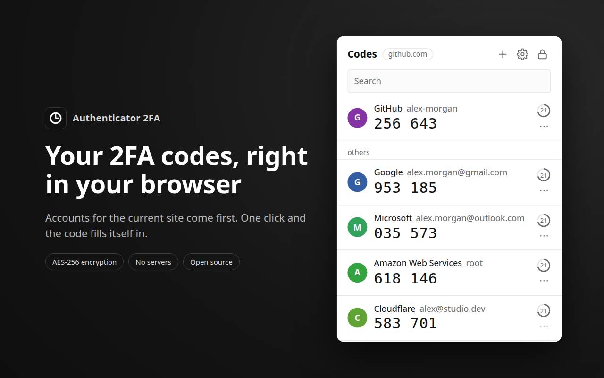

# Authenticator 2FA — browser extension

**English** · [Español](README.es.md)

Chrome extension (Manifest V3) to view your 2FA codes (TOTP/HOTP) right in the browser.
Import your accounts from the **Google Authenticator export QR code**
(`otpauth-migration://`), from standard `otpauth://` QR codes and links, or by entering the key manually.

**Version 1.0.1** · Made by [Andrés Yate](https://github.com/BgYato) · [MIT](LICENSE) license · [Privacy policy](PRIVACY.md) · [Changelog](CHANGELOG.md)



> **Note:** Google does not offer an API to read the Authenticator codes linked to a Google
> account (syncing is internal to the app). That is why every extension of this kind works
> with the export QR code, just like this one.

## Features

- Import the Google Authenticator export QR code, including when it is split into several QR codes ("1 of N" batches).
- **Live scanning with your computer's camera**: hold your phone in front of it and the QR codes add up as you move from one to the next.
- Read the QR code from an image: upload it, drag it, paste it with Ctrl+V or **scan the current tab**.
- **Select area**: manually draw a box around the QR code on a capture of the tab (useful when the QR is small or there are several on screen).
- Paste an `otpauth://` or `otpauth-migration://` link, or enter the Base32 key manually.
- TOTP codes with a countdown ring and HOTP codes with a counter. SHA1/SHA256/SHA512, 6 or 8 digits.
- During the last 5 seconds the next code is shown too, so you don't have to wait for it.
- Each service gets an avatar with its initial and a fixed color, so you can spot it at a glance.
- When you use a code, the row itself confirms whether it was filled in or copied.
- Copy a code with one click, search, rename and delete accounts.
- Duplicate detection when importing.
- **Encrypted vault:** AES-GCM 256 with a key derived from your master password (PBKDF2-SHA256, 600,000 iterations).
- Configurable auto-lock (5 min, 15 min, 1 h or when the browser closes), and also when the computer's screen locks.
- Password attempt limit: after 5 failures in a row you have to wait (30 s, doubling with each failure, up to 15 min).
- Encrypted backup to export and restore your accounts.
- Exporting the backup and deleting everything ask for the password again, even if the extension is unlocked.
- **Accounts for the open site first:** when you open the popup on `github.com`, the GitHub account appears at the top. It is inferred from the service name. If you use an account on a site it doesn't recognize, it asks whether to suggest it there from now on (if you say no, it won't ask again). You can also link domains in "Edit → Sites".
- **Fill in the code on the page:** when you click a code, if the site has a code field (`one-time-code`, one box per digit, or a field named "code", "otp"…) it is filled in directly instead of copied. It does not submit the form. Can be turned off in Settings.
- **Phishing warning:** if the site is not the account's site but looks like it (`g1thub.com`, `github-login.com`, `github.evil.com`), or the account has linked sites and this is none of them, it warns you before filling in or copying the code. You can cancel, use it once or remember the site.
- **Keyboard shortcut** `Ctrl+Shift+Y` to open the popup (change it in `chrome://extensions/shortcuts`). With the search box focused, ↑ ↓ pick the account and Enter uses it: shortcut → Enter → code filled in.
- The clipboard is cleared a few seconds after copying (configurable). Optionally, only if it still contains the code, so whatever you copied afterwards is not erased.
- In the search box, Esc clears the text.
- **Languages:** English, Spanish, Portuguese and French. By default it follows the browser language (English if not available); you can pick another one in Settings → Language and it applies immediately.
- The end of Settings shows the installed version and the author, with a link to the project.

## Installation (developer mode)

```bash
npm install        # downloads jsQR and copies it to src/vendor/
npm test           # unit tests (RFC 4226/6238 vectors and migration decoding)
```

1. Open `chrome://extensions`.
2. Turn on **Developer mode**.
3. Click **Load unpacked** and choose this folder (the one containing `manifest.json`).
4. Pin the extension to the toolbar.

It also works in Edge, Brave and other Chromium-based browsers.

## Packaging and publishing

```bash
npm test           # make sure everything passes before packaging
npm run package    # creates dist/authenticator-extension-<version>.zip
```

The script (`scripts/package.sh`) reads the version from `manifest.json` and puts only what is
needed in the zip: `manifest.json`, `LICENSE`, `_locales/`, `icons/` and `src/`. It requires the `zip` command.

**Testing the zip locally.** Chrome does not install a `.zip` directly: unzip it and load it
with **Load unpacked** in `chrome://extensions`. This way you check that no file is missing.

```bash
unzip dist/authenticator-extension-1.0.1.zip -d ~/authenticator-1.0.1
```

**Publishing on the Chrome Web Store.**

1. Go to the [Developer Dashboard](https://chrome.google.com/webstore/devconsole) (the first time
   you need to register as a developer, with a one-time fee of USD 5).
2. **New item** → upload the zip.
3. Fill in the listing (description, 128 px icon, at least one 1280×800 or 640×400 screenshot),
   the justification for each permission and the privacy policy URL
   (`https://github.com/BgYato/authenticator-2fa-extension/blob/main/PRIVACY.md`).
4. **Submit for review**.

**New versions.** Record the changes in `CHANGELOG.md` and bump `version` in `manifest.json` (and in `package.json`): 1.0.2 for
fixes, 1.1.0 for new features. The Web Store rejects a version equal to or lower than the
published one. Then run `npm run package` and in the Dashboard go to **Package → Upload new package**.

## Exporting from Google Authenticator

1. On your phone: Google Authenticator → ☰ menu → **Transfer accounts** → **Export accounts**.
2. Select the accounts → **Next**. One or more QR codes are shown.
3. In the extension click **＋** and then:
   - **Scan with camera**: a tab with the camera opens (the first time Chrome asks for permission).
     Put the phone's QR code inside the frame; if there are several, move to the next one on the phone
     and they add up automatically. When you have them all, click **Import**. **Or**
   - take a photo or screenshot of the QR code and upload, drag or paste it, **or**
   - open the image in a browser tab and click **Scan tab**. If it doesn't find it,
     click **Select area** and drag a box over the QR code; once read, it returns to your tab on its own.
4. If there are several QR codes (e.g. one per tab), scan them one by one: switch tabs, open the
   extension again and click **Scan tab**. What has been read is kept even if the popup closes,
   and it tells you which QR codes are missing ("QR codes read: 1, 3 of 3. Missing: 2").
5. Review the detected accounts and click **Import** (or **Cancel** to discard what was read).

> Screenshots of the export QR code contain **all your secrets**. Delete them
> (also from the trash and the cloud) when you are done.

## Project structure

```
manifest.json          version, author and project link (homepage_url)
LICENSE                MIT license
PRIVACY.md             privacy policy (the one linked from the Chrome Web Store)
CHANGELOG.md           changes in each version
_locales/              extension name and description in each language (used by Chrome)
icons/                 extension icons
src/background.js      service worker: auto-lock, lock with the screen and clipboard clearing
src/offscreen/         hidden document that clears the clipboard after the chosen time
src/popup/             popup interface (popup.html, popup.css)
  popup.js             startup, vault creation, unlocking and navigation
  ui.js                shared state, views, password confirmation
  list.js              code list, keyboard, fill/copy, per-site suggestion
  import.js            "Add" view (QR codes, links, manual entry)
  edit.js              account editing
  settings.js          settings, backup, wipe and version/author line
src/scan/              camera scanner in its own tab; decodes in a Web Worker
src/select/            manual selection of the QR area on a capture of the tab
src/ui/dom.js          shared DOM utilities (import list, toasts)
src/ui/i18n-boot.js    loads the language and translates the HTML before each page starts
src/i18n/              interface texts: es.js (reference), en.js, pt.js, fr.js
src/lib/
  base32.js            Base32 encoding of the keys
  totp.js              HOTP/TOTP with Web Crypto
  migration.js         decoder for Google Authenticator's otpauth-migration protobuf
  otpauth.js           parsing/generation of otpauth:// links
  accounts.js          account validation and normalization
  vault.js             encrypted vault (chrome.storage.local + chrome.storage.session)
  qr.js                QR reading from images (jsQR, loaded only when scanning)
  importer.js          cumulative import of several QR codes (shared by popup/scanner)
  sites.js             which accounts belong to the open site
  autofill.js          fills in the code on the page's field
  i18n.js              translations: t(), plurals and chosen language
src/vendor/jsQR.js     copied by `npm install` (do not edit)
scripts/               vendor.mjs (copies jsQR) and package.sh (zip for the Web Store)
test/                  tests with node:test (includes a mocked chrome.storage)
```

## Languages

Texts live in `src/i18n/<code>.js`. In the HTML they are marked with `data-i18n="key"`
(also `data-i18n-placeholder`, `-title` and `-alt`); in JavaScript use `t('key', { n })`.
`{ one, other }` values are plurals and `{name}` is replaced by the parameter.
`chrome.i18n` is not used for the interface because it only follows the browser language.

To add a language:

1. Copy `src/i18n/es.js` to `src/i18n/<code>.js` and translate the values.
2. Register it in `DICTS` and `LANGUAGES` in `src/lib/i18n.js`.
3. Add `_locales/<code>/messages.json` (name, description and shortcut in the Web Store and `chrome://extensions`).
4. `npm test` checks that it has the same keys, placeholders and plurals as Spanish (the reference).

## Security model

- Secrets are only stored **encrypted** in `chrome.storage.local`. They cannot be read without the master password.
- On unlock, the AES key is kept in `chrome.storage.session`: it lives only in memory,
  is deleted when the browser closes and content scripts cannot access it. This way you don't have to
  type the password every time you open the popup, within the auto-lock window.
- The extension makes no network requests and loads no remote code. Strict CSP (`script-src 'self'`, no iframes or objects).
- Permissions: `storage`, `activeTab` and `scripting` (scan the tab, suggest the account and fill in the code; only on the tab where you click the icon or press the shortcut, never in the background), `alarms` and `idle` (auto-lock and lock with the screen), `offscreen` and `clipboardWrite` (clear the clipboard after copying a code; configurable in Settings).
  None of them shows warnings on install.
  `clipboardRead` is **optional**: it is only requested if you turn on "Don't clear if you copy something else afterwards" and can be revoked by turning it off. It is used solely to compare the clipboard with the copied code before clearing it.
- A service worker deletes the session key as soon as the inactivity time expires or the screen locks,
  even if the popup is not opened.
- Before using a code the site is checked (`siteCheck` in `lib/sites.js`). A site is only trusted if it is a domain linked to the account or, if the account has none, if the issuer is the domain's name (`github.com` for "GitHub"). If the account has linked domains, only those count. If the site imitates the name (subdomains, hyphens or swaps like `1`→`i` and `rn`→`m`), you are warned before filling in or copying. Sites unrelated to the name cannot be told apart and you are only offered to link them; link your domains in "Edit → Sites" for maximum protection.
- After 5 wrong passwords in a row, an increasing wait is enforced.
- Older vaults with fewer PBKDF2 iterations are re-encrypted with the current value on unlock.
- The backup is encrypted with the master password in use when it was exported; it contains no plaintext secrets.
- Exporting asks for the password again if it hasn't been typed in the last 2 minutes; deleting everything always asks for it. So someone using your unlocked browser for a moment can see codes, but cannot take the keys.
- The camera needs no permission in the manifest: Chrome asks when the scanner opens and it can be
  revoked from the icon in the address bar. The video is processed locally and never saved.
  The scanner runs in a tab because an extension popup cannot show the permission prompt.
- The master password **cannot be recovered**. If you forget it, delete the data and import again.
- Keeping 2FA on the same computer as your passwords weakens the protection of the "second factor".
  Use it wisely and keep Google Authenticator on your phone as well.

## Ideas for future versions

- Generate `otpauth-migration` QR codes to move accounts back to the phone.
- Reorder accounts and mark favorites.
- Unlock with a passkey (WebAuthn PRF) on systems with Windows Hello or Touch ID.
- Encrypted sync between browsers with `chrome.storage.sync`.

## Author and license

Made by **Andrés Yate** — [github.com/BgYato](https://github.com/BgYato).

The extension does not collect or send any data: see the [privacy policy](PRIVACY.md).

Released under the [MIT](LICENSE) license. Includes [jsQR](https://github.com/cozmo/jsQR)
(Apache 2.0) to read QR codes.

This extension is not affiliated with or endorsed by Google. "Google Authenticator" is a trademark
of Google LLC and is mentioned only to indicate compatibility.
